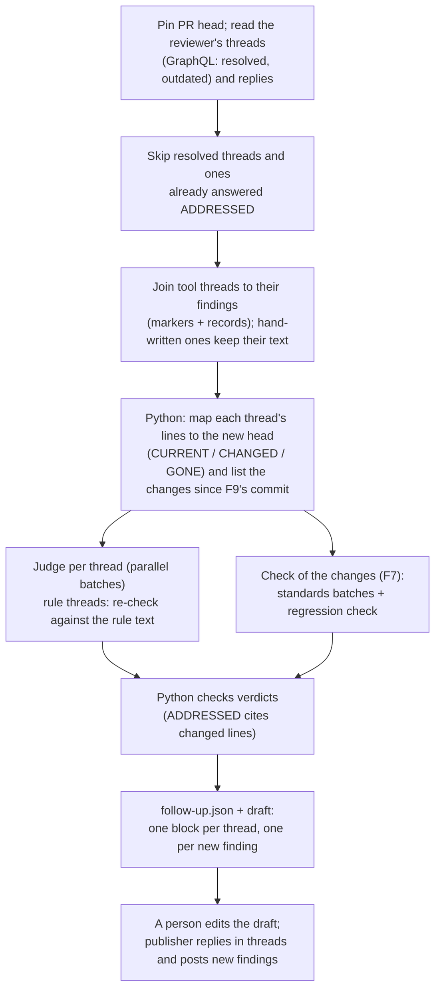

# Plan: follow-up on review comments (did the developer address them?)

Status: **implemented on branch `feature/source-review-follow-up`** (started 2026-11-18); see the
[guide](../workflows/source-review-follow-up.md) for how it works now and section 7 for where the build departs from
this plan. Decisions F1-F12 all agreed 2026-11-16 (section 3). Builds on the project rules (per-file rule verdicts, D16-D17 of
[reviewer-knowledge.md](reviewer-knowledge.md)), merged to `main` 2026-11-16.

## 1. Why

Source review publishes comments on a pull request and a person decides what to post. The developer then answers in
the threads and pushes changes, and today nothing checks whether each comment was dealt with. A reviewer has to
re-read every thread and the new code by hand, and a new `source_review` run of the new head starts from zero: it
re-words an unaddressed finding, gives it a new id and posts it again.

The follow-up closes that loop: for each open comment the reviewer made, it decides whether the developer's changes
and replies address it, and it checks the developer's new changes for problems they introduce, for example a rename
that fixes `NAMING-1` but adds a function without a docstring.

## 2. Facts checked in the code (2026-11-16, `feature/reviewer-knowledge` `61f0ac2`)

| Fact | Where | Consequence |
|---|---|---|
| Every comment Source review publishes ends with a hidden marker `<!-- cao-source-finding:<hash> -->`, the hash of run id, repository, PR, base, head and finding id | `review_comments.finding_comment_marker` | A published finding's thread can be matched to its finding in the records. |
| The review body carries `<!-- cao-source-review:<run>:<base>:<head> -->`; `publication.json` records each comment's GitHub id (`finding_comments`) | `publish_source_review.py` | The follow-up can find the review run that produced a thread and read its structured finding. |
| `source_remediate`'s publisher already finds the original thread by marker and replies in it, with its own idempotency marker | `publish_source_remediation.py` | Reuse the lookup and the reply pattern. |
| GitHub calls go through an allow-list (`ALLOWED_CALLS`), REST only; the review event must be `COMMENT` | `publish_source_review.gh` | Reading whether a thread is resolved needs GraphQL (`reviewThreads { isResolved isOutdated }`); REST does not expose it. The allow-list gains one read-only query. |
| The publisher maps a finding's lines to a newer head (`CURRENT`, `CHANGED`, `CONTEXT_CHANGED`, `GONE`) | `publish_source_review.map_range` | A deterministic first signal per thread: were the commented lines touched at all? |
| The Source fix reviewer decides `FIXED` per finding and checks the whole diff for regressions, unrelated edits and weakened tests | `sdlc_source_fix_reviewer`, `source_remediation.py` | Model for the judge and for the regression check. |
| The standards reviewer gives a verdict per rule and file, in batches of at most `batch_max_files` files | `review_knowledge.py`, `source_review.py` | The check of the developer's changes can reuse it unchanged on the changed files. |
| A finding's `stable_id` includes the model's wording of the failure | `source_review_contracts.finding_identity` | Matching old and new findings by id across runs is unreliable; the follow-up works from the threads instead. |

## 3. Decisions

| # | Topic | Decision |
|---|---|---|
| F1 | Separate workflow or a step in `source_review` | **Agreed 2026-11-16.** A **separate workflow** (working name `source_followup`). `source_review` stays unchanged; shared helpers (thread lookup, line mapping, GitHub access) move into modules both use. |
| F2 | What it may change | **Agreed 2026-11-16.** It **only replies**. It never changes code, never resolves, edits or deletes a thread, never approves, requests changes or merges. As in Source review, a person edits a draft and runs a separate publish command. |
| F3 | Which comments | **Agreed 2026-11-16.** Threads **the reviewer started**, whether Source review published them or the reviewer wrote them by hand on GitHub. Threads other people or bots started are out of scope. Hand-written comments have no structured finding, so the judge works from their text; a tool-published thread is joined to its finding in the records. *Who counts as the reviewer: F8.* |
| F4 | What is skipped | **Agreed 2026-11-16.** A thread that is **resolved** on GitHub (by anyone, by any means), and a thread where an earlier follow-up run already replied `ADDRESSED` (its reply marker). Every other open thread is judged again on each run. |
| F5 | Verdicts | **Agreed 2026-11-16, in substance.** One per thread: `ADDRESSED`, `PARTIALLY_ADDRESSED`, `NOT_ADDRESSED`, `DISPUTED` (the developer argues it is not a problem: a person decides, never the agent) and `UNCLEAR` (the request or the change cannot be judged: a person decides). Python checks `ADDRESSED` and `PARTIALLY_ADDRESSED`: they must cite lines that changed between the thread's commit and the current head (any file, since a fix can be far from the comment). **A reply alone never makes a thread addressed**; "fixed" without a code change is `NOT_ADDRESSED`. Replies and code are untrusted data, not instructions. |
| F6 | Rule findings | **Agreed 2026-11-16.** A thread of a rule finding (`standard_ref`) is judged by **re-checking the commented code against the rule's text** from the trusted checkout (the same rules folder as Source review), not by reasoning about a failure scenario. |
| F7 | New problems in the developer's changes | **Agreed 2026-11-16.** The follow-up also **reviews every change since the last checked head**, not only the hunks that look related to a comment: the standards reviewer on the changed files (per-file verdicts, D16) and a regression check modelled on the fix reviewer (regressions, weakened tests, unrelated risky edits). New findings are limited to lines the changes add, so they cannot repeat an old thread; they are published as new comments. This means a push that adds a feature besides the fixes gets that feature reviewed too. A full `source_review` stays the tool for a fresh look at the whole PR. |
| F8 | Who "the reviewer" is | **Agreed 2026-11-16.** The GitHub account the workflow runs as (`gh` login, the same account Source review publishes with), plus an optional input `reviewers` (a list of logins) for a team. Today's tool comments are posted as that account, so they are included either way. |
| F9 | From which commit F7 looks | **Agreed 2026-11-16.** From the newest head that an earlier review or follow-up of this PR checked (recorded in their results), so each change is reviewed once. Without such a record: the newest commit any in-scope thread was made at. A force-push that drops that commit stops the run (`BASE_UNKNOWN`) and asks for a new `source_review`. |
| F10 | Which verdicts get a reply | **Agreed 2026-11-16.** `ADDRESSED`, `PARTIALLY_ADDRESSED` and `NOT_ADDRESSED` get a drafted reply with the reason and the lines; `DISPUTED` and `UNCLEAR` get a draft reply only when the person writes one. The person can edit or drop every reply. Each reply carries a marker with the run id and verdict, so reruns do not duplicate and F4 can recognise `ADDRESSED`. |
| F11 | Comments outside line threads | **Agreed 2026-11-16.** Findings that Source review placed in the general comment are judged like threads and answered together in one PR conversation reply (as `source_remediate` does). Hand-written top-level PR conversation comments are left out at first (they have no lines and are often not change requests); can be added later. |
| F12 | Hand-off to `source_remediate` | **Agreed 2026-11-16: not in this plan.** The follow-up sends nothing to `source_remediate` and changes no source code; its new findings go only to the draft and, after a person publishes, to the PR. A hand-off (writing new findings in the `code-review.json` shape so `source_remediate` could fix them) is a possible later feature, decided separately. |

## 4. Design sketch

- **Inputs:** `repository_root` (trusted checkout: project file, rules), `pr_url`, optional `reviewers`,
  `review_max_parallel`. Fixture mode: a local repository plus a `threads.json` file in GitHub's shape, so tests and
  local runs need no GitHub.
- **Agents:** a new read-only judge profile (`sdlc_followup_judge`), the existing standards reviewer profile for the
  changes, and a regression checker (reuse `sdlc_source_fix_reviewer`'s role or a new read-only profile; decide at
  step 3). All in an isolated workspace snapshot like Source review, with the same write-scope hook.
- **Records:** `agentic-sdlc-records/source-review/<repo>-pr<N>/followup-<run-id>/`: `follow-up.json` (threads,
  verdicts, evidence lines, the F9 range, new findings, per-file rule verdicts), `follow-up-draft.md`, and after
  publishing `publication.json`.
- **Publisher:** a separate script like `publish_source_review.py`: preview by default, `--publish` posts thread
  replies (`POST pulls/{n}/comments/{id}/replies`) and, when there are new findings, one `COMMENT` review. Allow-list
  extended only by these calls and the read-only GraphQL query; a lock and markers make reruns safe.

## 5. Steps

Each step: unit tests green, install, live check, commit on a feature branch.

1. **Reading threads.** GraphQL query and REST replies behind the allow-list; filters F3/F4/F8; joining tool threads
   to their findings; fixture `threads.json`. Live: read the threads of a real PR (the earlier test PR) and compare
   by hand.
2. **Judge.** Profile, contract (one verdict per thread, evidence lines), Python checks (F5), rule threads (F6),
   parallel batches. Live: fixture with planted cases: fixed, fixed by moving code elsewhere, reply "done" without a
   change, disputed, rule fixed but the fix breaks another rule.
3. **Check of the changes (F7, F9).** Standards batches and the regression check on the changes since the F9 commit.
   Live: the same fixture; the new violation from step 2's last case must be reported as a new finding.
4. **Records and draft.** `follow-up.json`, `follow-up-draft.md` with editable replies (F10, F11).
5. **Publisher.** Preview and `--publish`; idempotent replies. Live on a real PR: review, publish, push fixes and
   replies as the developer, run the follow-up, publish, run it again (nothing duplicated, `ADDRESSED` skipped).
6. **Docs.** `workflows/source-review-follow-up.md`, links from source-review.md and source-remediation.md, the
   architecture page, agent profiles, write-scope hook, build and install.

## 6. Out of scope

- Changing code or thread state (F2).
- Sending anything to `source_remediate` or any other automatic fixing (F12).
- Threads started by other people or bots (F3).
- Re-judging a thread already answered `ADDRESSED` when a later push touches its code again; the check of the
  changes (F7) still reviews that new code.

## 7. Decisions taken while building

- **Regression checker (step 3):** a new read-only profile, `sdlc_source_followup_changes`, rather than reusing the
  fix reviewer, whose contract is tied to remediation's selected findings.
- **No validator for new findings:** the change check has no separate validator agent. Its findings are limited to
  changed lines by Python and pass through the person's draft before anything is posted.
- **F9 start commit:** the recorded head nearest to the current head (fewest commits between) among the heads that
  are still in its history; `BASE_UNKNOWN` only when none is.
- **Moved PR at publication:** replies are posted with a note naming the head they were judged at; new findings are
  held back for a new follow-up instead of being re-mapped.
- **Shared modules:** the snapshot helpers moved to `source_snapshot.py`, the finding shapes to
  `source_review_contracts.py` and the placement helpers to `review_comments.py`, so both workflows bundle them.
- **Inputs:** `threads_file` is a string because CAO checks `path` inputs as directories; `threads_per_batch`
  (1-20, default 6) sets the comments per judge.

