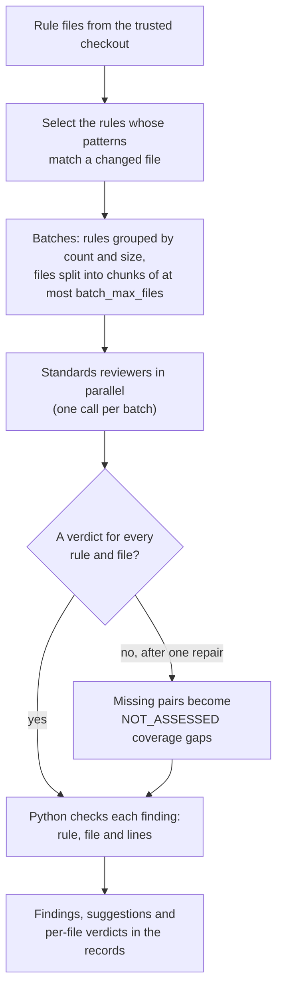

# Project rules for the reviewers

A project can give Delivery and Source review its own coding standards: rules such as "identifiers are full words"
or "no change-history comments". A dedicated standards reviewer checks the code a change adds against them, and the
agents that write code are told which rules apply to the files they change. Without rules, both workflows behave as
if this feature did not exist.

This page describes the rule files, the settings and how the workflows use the rules. The workflow guides describe
what each workflow does with the results: [Delivery](../workflows/delivery.md#project-rules) and
[Source review](../workflows/source-review.md#project-rules).

## At a glance

| | |
|---|---|
| Where the rules live | Markdown files in `agentic-sdlc-pr-review-kb/` at the repository root |
| How they are enabled | `review_knowledge` in the project's `agentic-sdlc-project.json` lists the files to use |
| Who checks them | `sdlc_standards_reviewer` (Delivery) and `sdlc_source_standards` (Source review), read-only |
| Who follows them | Delivery's implementer, code supervisor, workers, integration and remediator; Source remediation's remediator and fix reviewer |
| Trust | Read from the checkout the workflow runs from, never from the reviewed change; no agent may write the folder |
| Changing a rule | Edit the file; the next run uses it. No reinstall |

## Writing a rule file

Each file holds one or more rules. A rule starts with a heading in exactly this form and has five sections:

```markdown
## NAMING-1 - [MANDATORY] Readability. Identifiers are full, self-explanatory names

### Applicable files

- `app/**/*.py`
- `app/**/*.js`

### Rule description

What the code must do or avoid, with the exceptions.

### Why we have the rule

The reason, so a reviewer can judge borderline cases.

### Examples: bad

(code blocks)

### Examples: good

(code blocks)
```

- **Id:** capital letters and digits, a hyphen and a number (`NAMING-1`, `PY-12`). Ids are unique across all files.
- **Level:** `MANDATORY` or `NICE-TO-HAVE`. A violation of a `NICE-TO-HAVE` rule is only a suggestion (see
  [Findings](#findings)).
- **Domain and title:** the domain ends at the first full stop; the title follows. Both appear in the short index the
  agents receive, so make the title say the rule.
- **Applicable files:** one `` - `glob` `` line per pattern, relative to the repository root. `**` matches any number
  of folders. A rule is used only for changed files that match one of its patterns.
- **Sections:** all five, each once, with these exact names. Other `###` headings are refused. Headings inside code
  blocks are ignored, and every code block must be closed.
- **Size:** a rule's text may not exceed `max_rule_kb`. The agents get only the index in their prompt and read a rule's
  full text when they need it, so the examples cost nothing unless a rule is in doubt.

Anything that does not follow this format stops the run before any agent starts, with the file and the rule named.
[`code-readability.md`](../../agentic-sdlc-pr-review-kb/code-readability.md) holds two complete rules to copy from.

Tips:
- Say in the description which code the rule covers, for example "names that the change adds or renames". Reviewers
  check only the lines a change adds, but the rule text decides borderline cases.
- List the exceptions. A reviewer applies a rule literally; an exception that is not written down becomes a finding.
- Keep one concern per rule. A rule with one clear question gets a clear verdict.

## Enabling the rules

List the files in `review_knowledge` in `agentic-sdlc-project.json`. Only `files` is required; it is an explicit
list, so a draft file in the folder is never used by accident.

```json
{
  "version": 1,
  "source_roots": ["app"],
  "review_knowledge": {
    "files": ["agentic-sdlc-pr-review-kb/code-readability.md"],
    "batch_max_files": 5
  }
}
```

| Setting | Default | Allowed | Meaning |
|---|---|---|---|
| `files` | (required) | 1 to `max_files` paths | `.md` files inside `agentic-sdlc-pr-review-kb/` |
| `batch_max_rules` | 15 | 1-50 | Rules in one reviewer call |
| `batch_max_kb` | 32 | 4-128 | Rule text in one reviewer call |
| `batch_max_files` | 5 | 1-50 | Changed files in one reviewer call |
| `max_files` | 32 | 1-128 | Rule files |
| `max_rules` | 200 | 1-1000 | Rules in all files together |
| `max_rule_kb` | 8 | 1-32 | Size of one rule; may not exceed `batch_max_kb` |

An unknown key, a value out of range, a missing file or a path outside the folder stops the run before any agent
starts. The project file is described in [Source roots](../workflows/delivery.md#source-roots).

## How a review uses the rules



1. **Selection.** Rules whose patterns match no changed file are skipped and cost nothing; the records list them.
2. **Batches.** The applicable rules are grouped within `batch_max_rules` and `batch_max_kb`. Each group's changed
   files are split into even chunks of at most `batch_max_files`, and each batch is one group with one chunk, so every
   rule and file pair is reviewed exactly once. A reviewer sees only its batch's files and their part of the diff.
   Batches are deterministic: the same rules and changed files give the same batches.
3. **Review.** Each batch is one call to the standards reviewer, run beside the other reviewers, at most
   `review_max_parallel` at a time. The reviewer gets the short index of its rules and files and reads a rule's full
   text when it needs the exceptions or examples. It reports every occurrence of a violation, one finding per rule
   and location, and cites the rule (`standard_ref`).
4. **Verdict per rule and file.** For each rule in its batch the reviewer gives one verdict per file:
   `VIOLATED` (listing the findings for that rule in that file), `NOT_VIOLATED`, or `NOT_ASSESSED` with a reason.
   Python requires an entry for every pair. A missing one gets one repair turn; if it is still missing, it is
   recorded as `NOT_ASSESSED` with a coverage gap and the run continues. A rule's overall verdict is `VIOLATED` in any
   file, else `NOT_ASSESSED` in any file, else `NOT_VIOLATED`.
5. **Checks.** Python rejects a finding that cites a rule outside the batch, a file the rule does not cover, or lines
   that do not exist, and gives the reviewer its repair turn.

The verdicts prove that no rule and file was skipped silently. They do not prove that a `NOT_VIOLATED` verdict is
right: that is still the reviewer's judgment.

### Findings

A rule violation is a finding even without a failure scenario. The workflow's normal routing then applies, with
three additions:

- **Severity.** The reviewer rates a violation normally `LOW` or `MEDIUM` for a `MANDATORY` rule and `LOW` for a
  `NICE-TO-HAVE` rule, higher only when it also causes a concrete problem. The workflow keeps the reviewer's rating.
- **Suggestions.** A violation of a `NICE-TO-HAVE` rule, unless rated `HIGH`, and a finding on lines the change does
  not add are suggestions: reported, never fixed automatically, never blocking.
- **Sensitive code goes to a person.** A rule finding in a sensitive file (one with a protected boundary such as
  business rules or a public API) goes to a person even when the fix is a rename. Source review uses the mapper's
  protected boundaries for the file; Delivery uses the PR reviewer's findings with a protected category on the same
  file in the same round.

Each workflow guide describes where findings, suggestions and verdicts appear in its records.

## How authors use the rules

The agents that write code get an index of the rules that can apply to the files they will change, with the path to
each rule's full text, and are told to follow `MANDATORY` rules always and `NICE-TO-HAVE` rules where reasonable,
only in code they add or change. A remediator always also gets the rules its findings cite. Authors get the same
rules the reviewers check, so most violations are avoided before the review.

## Trust and audit

- The rules come from the checkout the workflow runs from: Delivery's repository, or Source review's
  `repository_root`. A pull request that edits a rule file does not change the rules used to review it.
- `agentic-sdlc-pr-review-kb/` is denied to every agent by the [write-scope hook](write-scope-hook.md), and it may not
  be configured as a source root. The standards reviewers are read-only profiles.
- Each run copies the rules it uses into its working folder and records every file's path and SHA-256, the settings,
  the applicable and skipped rules, the batches and the verdicts.

## Cost

Each batch is one agent call. A change touching 12 files with 8 applicable rules makes 3 calls with the defaults
(files in chunks of 4, 4 and 4). Smaller `batch_max_files` means more, smaller calls and closer attention per file;
larger means fewer calls. Rules that match no changed file are free.

## See also

[Delivery](../workflows/delivery.md) · [Source review](../workflows/source-review.md) ·
[Source remediation](../workflows/source-remediation.md) · [Agent profiles](agent-profiles.md) ·
[Write-scope hook](write-scope-hook.md)
