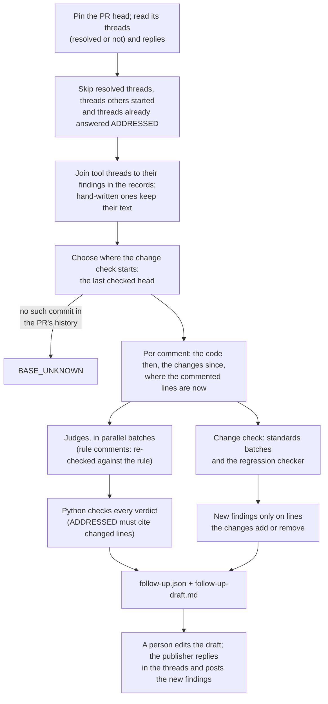

# Follow-up on review comments (`source_followup`)

After [Source review](source-review.md) publishes comments on a pull request, the developer answers in the threads and
pushes changes. The follow-up checks, for every open comment the reviewer made, whether those changes address it, and
reviews the changes themselves for new problems. It drafts replies; a person edits the draft and runs a separate
command to post them.

It only replies. It never changes code, never resolves, edits or deletes a thread, never approves or requests changes,
and never merges. It sends nothing to [Source remediation](source-remediation.md).

## At a glance

| | |
|---|---|
| Registered name | `source_followup` |
| Agents | Follow-up judge (`sdlc_source_followup_judge`), regression checker (`sdlc_source_followup_changes`) and the standards reviewer (`sdlc_source_standards`, shared with Source review) |
| Done by Python | Reading the threads, choosing which to judge, the code and changes behind each one, checking every verdict, choosing where the change check starts, placing new findings, the draft, publication |
| Requires | An open PR with comments the reviewer started; for the change check, an earlier Source review or follow-up of the PR, or a thread made at a commit still in the PR's history |
| Human gate | A person edits `follow-up-draft.md` and decides whether to run the publisher. A person writes the replies to `DISPUTED` and `UNCLEAR` threads. |
| Results | `agentic-sdlc-records/source-review/<repo>-pr<N>/followup-<run-id>/` |
| Write boundary | Every agent: its answer area in an isolated workspace only. The publisher: replies and one `COMMENT` review. |

## How it works



1. **Read the threads.** Python pins the PR's base and head in a private object store and reads every review thread
   with one fixed, read-only GraphQL query (REST does not say whether a thread is resolved), plus the reviews and the
   PR conversation. A push while reading stops the run.
2. **Choose.** A thread is followed up when a reviewer started it: the `gh` account the workflow runs as, or a login
   in the `reviewers` input. Threads other people or bots started are left out. A thread is skipped when it is
   resolved on GitHub, or when a reviewer already posted a follow-up reply with the verdict `ADDRESSED` in it. Only a
   reviewer's own comments count, so a developer cannot mark a thread addressed by pasting a marker. Findings that
   Source review placed in its general comment are followed up the same way, as long as that review is still on
   GitHub. Hand-written PR conversation comments are left out.
3. **Join.** A thread that Source review (or an earlier follow-up) published is joined to its structured finding in
   the trusted records, by the hidden marker in its first comment or, for older reviews, through `publication.json`.
   A hand-written thread is judged from its text.
4. **Prepare each comment.** For every comment Python writes the commented code at the commit it was made at, every
   change from that commit to the head (in any file: a fix can be far from the comment), and where the commented
   lines are now: `CURRENT` (unchanged, maybe moved), `CHANGED`, `GONE` (the file was removed), `BASE_SIDE` (a comment
   on removed code), `FILE` (a comment on a whole file) or `COMMIT_UNKNOWN` (the commit is no longer available). A
   comment about a project rule gets the rule's text from the trusted checkout.
5. **Judge.** The judges decide each comment in parallel batches: `ADDRESSED`, `PARTIALLY_ADDRESSED`, `NOT_ADDRESSED`,
   `DISPUTED` (the developer argues it is not a problem; a person decides) or `UNCLEAR` (it cannot be judged). Python
   checks every answer: `ADDRESSED` and `PARTIALLY_ADDRESSED` must cite at least one line that changed since the
   comment, so a reply saying "done" without a change is never addressed. A rule comment is re-checked against the
   rule's text and is `ADDRESSED` only when the code no longer violates it. The judges draft a reply for the first
   three verdicts; the other two get none.
6. **Check the changes.** At the same time, the standards reviewer checks the project rules on the changed files and
   the regression checker looks for behaviour the changes break, weakened or removed tests and risky edits nobody
   asked for. The check covers every change since the newest head an earlier Source review or follow-up of this PR
   checked (from their results). Without such a record it starts at the newest commit an open thread was made at. New
   findings count only on lines the changes add (or, for removed code, remove), so they cannot repeat an old thread.
   A push that also adds a feature gets that feature reviewed too.
7. **Results.** Python places each new finding beside the code when its lines are in one changed section of the PR's
   diff, and writes `follow-up.json` and the editable draft.

## Before you run it

1. A running `cao-server` and a configured `claude_code` provider.
2. Source review installed (the follow-up uses its `sdlc_source_standards` profile), then the follow-up. Its installer
   validates and installs its two profiles and refuses to run without the standards profile:

   ```bash
   bash .agentic-sdlc/cao/workflows/install_source_followup.sh "$PWD"
   ```

3. `gh` authenticated on the server host as the reviewer's account (the account Source review publishes with).
4. The PR's earlier Source review results in this checkout's `agentic-sdlc-records/source-review/`, if its comments
   should be joined to their findings. Without them every thread is judged from its text.

## Inputs

| Input | Required | Meaning |
|---|---|---|
| `repository_root` | yes | The trusted checkout: project file, project rules and records. The PR's code is never run or checked out. |
| `pr_url` | for a GitHub PR | `https://github.com/OWNER/REPO/pull/NUMBER`. The PR must be open. |
| `reviewers` | no | Comma-separated GitHub logins whose threads are followed up as well as the `gh` account's own. |
| `source_repository`, `base_sha`, `head_sha`, `threads_file` | for a local fixture | A local repository, the PR's base and head, and a `threads.json` file in GitHub's shape (see [Configuration](#configuration)). Do not combine with `pr_url`. |
| `review_max_parallel` | no | Agents run at the same time, 1 to 4 (default 4). |
| `threads_per_batch` | no | Comments per judge, 1 to 20 (default 6). |

## Run

Use a fresh run ID every time:

```bash
cao workflow run source_followup --run-id followup-pr42-1 \
  --input repository_root="$PWD" \
  --input pr_url=https://github.com/OWNER/REPO/pull/42
```

## Results

```text
agentic-sdlc-records/source-review/<repo>-pr<N>/followup-<run-id>/
├── follow-up.json        threads, verdicts, evidence lines, the change check, new findings, rule verdicts
├── follow-up-draft.md    the editable replies and new findings
└── publication.json      written later by the publisher: what was posted
```

A local fixture without a PR identity uses `local-<head12>/followup-<run-id>/`. The working files (object store,
snapshot, item files, agent answers) stay in `.agentic-sdlc/runtime/source-followup/<run-id>/`, which Git ignores.

In `follow-up.json`, each entry of `items` holds the comment (`request`, `replies`, `url`), where it was made, its
`location`, the `verdict`, the `reason`, the cited `evidence` and the drafted `reply`; `skipped` lists the threads
left out and why; `changes` names the commit the change check started at; `findings` holds the new findings and
`outside_changes` those discarded because they were not on changed lines. Status `STALE` means the PR moved or
closed while the run worked; the draft can still be published.

## When a run stops early

| Outcome | Meaning | What to do |
|---|---|---|
| `BASE_UNKNOWN` (in `failure.json`) | No earlier review or follow-up is recorded and no open thread names a commit, or none of those commits is in the PR's history any more (a force-push). | Run a new [Source review](source-review.md). |
| `FAILED` | The PR is closed, it moved while the threads were read, the inputs are invalid, the changes exceed 2 MB, or an agent's answer failed its contract twice. | Read `failure.json` in the runtime folder and `cao workflow result <run-id> --json`; start a new run with a fresh run ID. |
| Run refused at once | The run ID is invalid or already used. | Use a fresh run ID. |

## Human decisions

### Edit the draft

`follow-up-draft.md` opens with a summary: how many comments got which verdict, what was skipped, the change check
and its coverage gaps, and the comments that need your reply. Each comment then shows the original request, the
judge's reason and a reply block:

```text
<!-- reply item="T3" verdict="NOT_ADDRESSED" publish="yes" -->
parse_quantity at app/billing/invoice.py:17-18 still accepts 0 and negative quantities. ...
<!-- end reply -->
```

You may edit the text, set `publish="no"`, or change the `verdict`. The posted reply records the verdict you leave:
set `ADDRESSED` to accept a developer's argument, and later follow-ups skip that thread. `DISPUTED` and `UNCLEAR`
blocks start empty with `publish="no"`: write a reply and set `publish="yes"` to answer. Replies to `G` items
(findings from a review's general comment) are posted together as one PR conversation comment.

New findings have a block each, with an `anchor` (`path:RIGHT|LEFT:start-end` inside the PR's diff, or `general`),
plus one general block that becomes the review's body. Adding blocks is not supported.

### Publish

```bash
python3 .agentic-sdlc/scripts/publish_source_followup.py \
  agentic-sdlc-records/source-review/repo-pr42/followup-followup-pr42-1
```

| Command | Effect |
|---|---|
| no flag | Preview: parses the draft, checks every thread and anchor against the PR as it is now, and prints the replies and the review request. Writes nothing. |
| `--publish` | Posts one reply per published thread block, one PR conversation comment for the `G` replies, and one review with event `COMMENT` holding the new findings. |

A thread resolved or deleted after the run gets no reply. If the PR moved since the run, every reply starts with a
note saying which head it was judged at, and the new findings are held back: run a new follow-up for them. A new
finding whose anchor is no longer in one changed section of the diff goes to the review's body.

Every reply carries a hidden marker with the run ID, the thread (or finding) and the verdict, and the review carries
a marker with the run ID. Publication is not atomic; `publication.json` records each step. Run the same command again
after a failure: what is already on GitHub is reused, not posted twice. A surviving `publication.lock` in the runtime
folder means another invocation is running or crashed: check the PR before removing it. Comments that the follow-up
publishes are joined to its findings by later follow-ups, like Source review's.

## Configuration

- **Project rules:** the follow-up reads the same [project rules](../reference/project-rules.md) as Source review
  from the trusted checkout. They decide which rules the standards reviewer checks on the changed files and give the
  judges the text of the rule a comment cites. A rule that no longer exists is reported as a coverage gap.
- **Local fixture:** `agentic-sdlc-local-inputs/source-followup/create_fixture.py <folder>` builds a trusted checkout
  with rules and the records of a published review, a PR repository with the reviewed head and the developer's push,
  and a `threads.json` with planted cases. It prints the inputs; `expected.json` beside them lists the verdicts a
  correct run gives. `threads.json` holds `login`, optional `repository` and `pr_number` (to join the records),
  `threads` (GraphQL `reviewThreads` nodes), `reviews` and `issue_comments`. A fixture run cannot be published.

## Safety boundaries

- The PR's code is exported as plain data from a private object store, never checked out or run; agent control files
  in it are left out. Every agent runs in an isolated workspace whose write guard allows only its answer file, and
  the `sdlc_source_` profiles are always read-only (see [Agent answers and write scope](../reference/write-scope-hook.md)).
- Comments, replies and code are untrusted data for every agent. A verdict that claims a change must cite lines that
  really changed; Python checks it, so instructions in a reply cannot make a thread addressed.
- A thread counts as answered only through a reviewer's own comment; the reviewers are the `gh` account and the
  `reviewers` input.
- GitHub reads go through a fixed allow-list (`review_threads.ALLOWED_READS`), with one read-only GraphQL query.
  The publisher's writes are limited to thread replies, PR conversation comments and `COMMENT` reviews
  (`ALLOWED_WRITES`); it never resolves, edits, deletes, approves, requests changes or merges.
- Nothing goes to Source remediation, and no code changes.

## Tests

`tests/test_source_followup.py` covers the allow-lists, thread selection and skipping, joining threads to findings
(by marker, receipt and older reviews), general findings, the item files and line mapping on the planted fixture,
every verdict check, the choice of the start commit (including `BASE_UNKNOWN`), the change check's line limits, the
draft's format and errors, and the publisher (replies, reruns without duplicates, a moved PR, resolved or deleted
threads, anchors outside the diff) with GitHub simulated. See [build and install](../build-and-install.md#tests) for
how to run them.

## See also

[Source review](source-review.md) · [Source remediation](source-remediation.md) ·
[Project rules](../reference/project-rules.md) · [Agent profiles](../reference/agent-profiles.md) ·
[Plan](../plans/source-review-follow-up.md)
